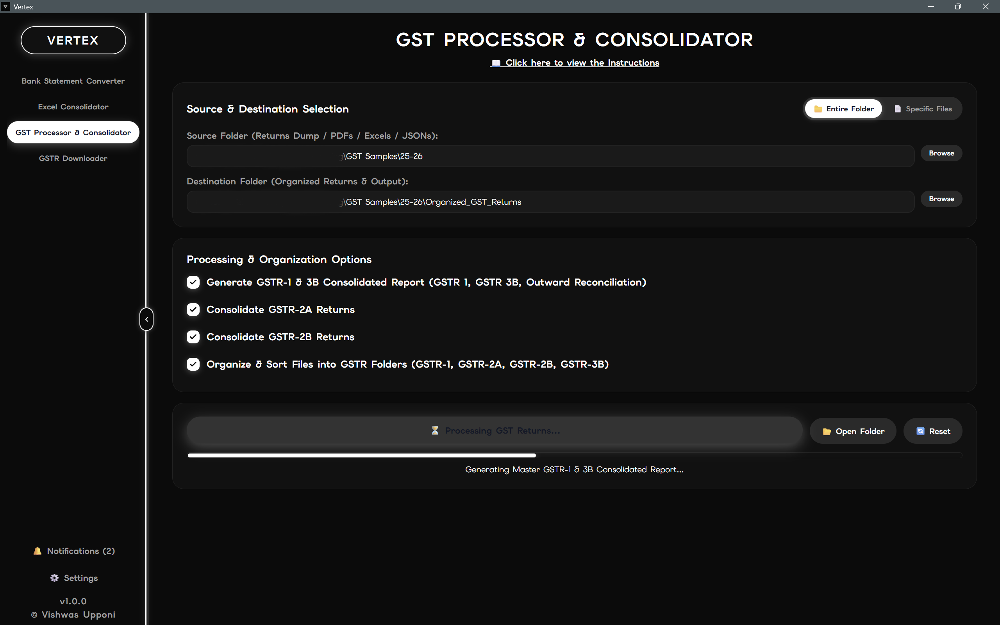
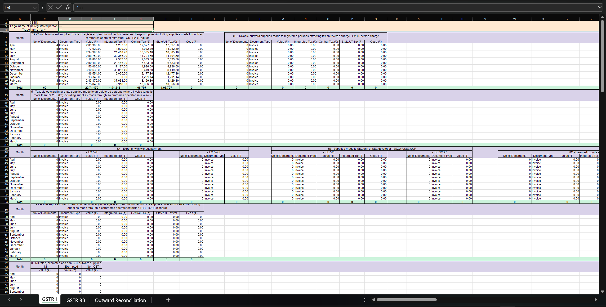
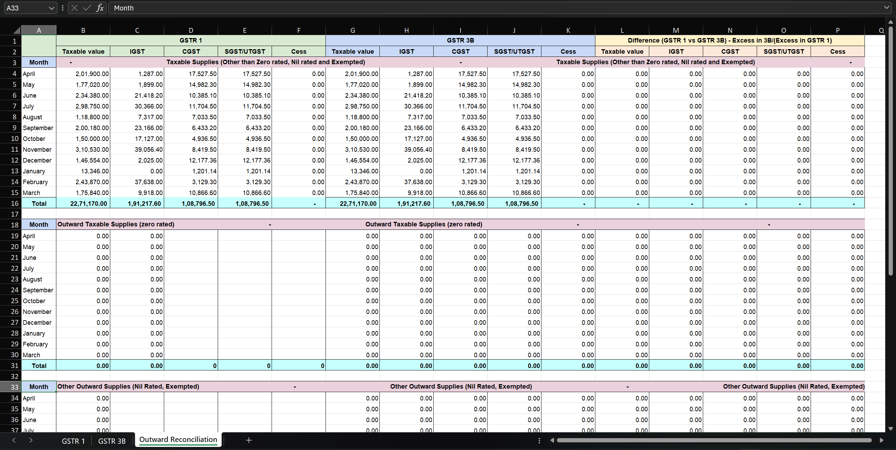
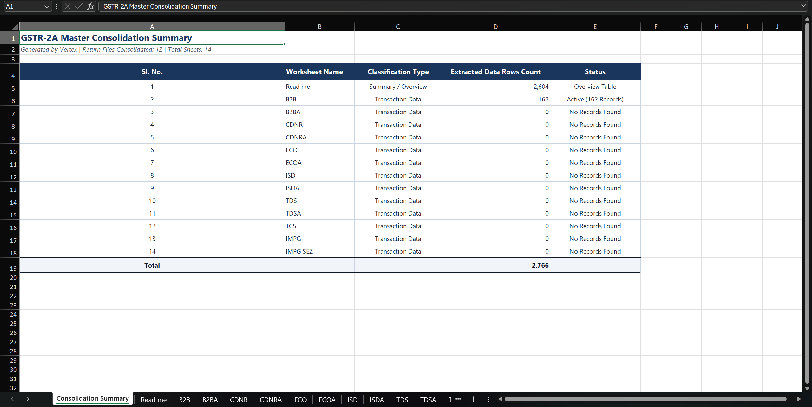
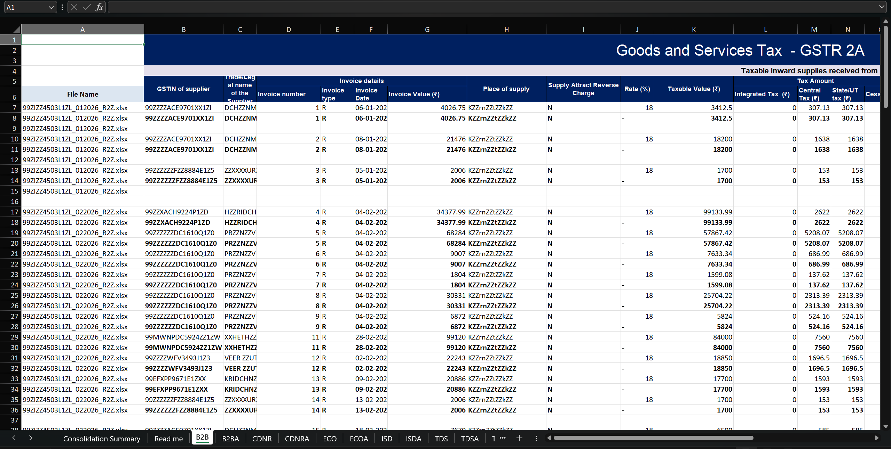
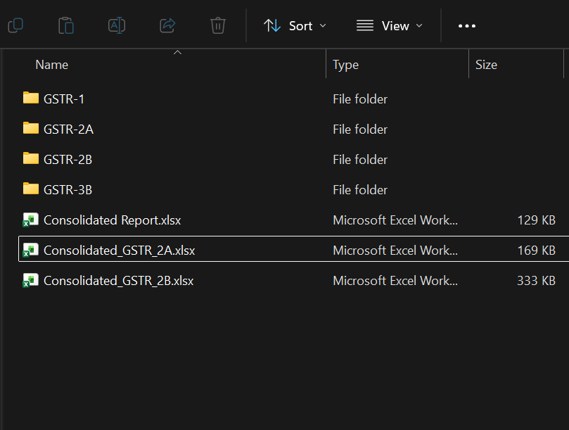

# GST Processor & Consolidator

GST Processor & Consolidator is an official addon module for the **Vertex Application**. It categorizes unorganized dumps of GST return files and consolidates them into structured, multi-sheet Excel reports. Designed to streamline GST return analysis, it generates unified GSTR-1 and GSTR-3B comparative reports with outward reconciliation, merges multi-month GSTR-2A and GSTR-2B workbooks, and automatically organizes returns into categorized folders.

> [!NOTE]
> **Internet Usage**: 100% offline. All GST return parsing, categorization, and report generation run locally on your computer and do not use an internet connection.

---

## 📸 Screenshots

### Processor Interface

### GSTR-1 & 3B Consolidation

### Outward Reconciliation

### GSTR-2A & 2B Consolidation

### Automatic Folder Organization

---

## ✨ Key Features

- **📊 GSTR-1 & 3B Consolidated Master Report**: Automatically parses GSTR-1 and GSTR-3B PDF returns across months to generate a unified multi-sheet workbook complete with sales summaries, tax payment details, and dynamic Outward Reconciliation formulas.
- **📑 GSTR-2A & GSTR-2B Multi-Month Consolidation**: Merges multi-month GSTR-2A and GSTR-2B Excel workbooks and portal ZIP archives into unified, chronological spreadsheets while preserving original formatting and layout.
- **🗂️ Automatic Return File Organization**: Scans unorganized dumps of return files (PDFs, Excels, JSONs) and safely categorizes them into dedicated folders for GSTR-1, GSTR-2A, GSTR-2B, and GSTR-3B.
- **⚡ High-Volume Local Processing**: Efficiently parses and organizes return files locally in seconds with zero cloud dependencies.

---

## 📥 Installation

### Via Vertex Module Manager (Recommended)
1. Open the **Vertex Application**.
2. Go to **Settings** in the sidebar and then **Module Manager**.
3. Switch to the **Cloud Store** tab, locate **GST Processor & Consolidator**, and click **Install**.
4. The addon will automatically download, install, and appear in your active sidebar navigation.

### Manual Package Installation
1. Download the latest release `.vtx` package from the [Releases](https://github.com/vishwasupponi/vtx-gst-processor/releases) page.
2. In Vertex Module Manager, click **"Install Local File"** and choose the downloaded package.

---

## 🚀 Getting Started

1. **Open Tool**: Select **GST Processor & Consolidator** from the sidebar navigation.
2. **Select Source & Destination**: Choose whether to process an **Entire Folder** or **Specific Files** containing your unorganized GST return files (PDFs, Excels, JSONs), and select your destination folder.
3. **Choose Options & Run**: Check your desired processing options (GSTR-1 & 3B consolidated report, GSTR-2A consolidation, GSTR-2B consolidation, or file organization), then click **"Start Processing & Generate Reports"**.

> For more information, check the **Instructions** manual inside Vertex.

---

## 🤝 Contributing & Security

- You are free to develop custom plugins for personal use. To propose a module for the official Cloud Store catalog or submit contributions, see [CONTRIBUTING.md](CONTRIBUTING.md).
- To report a security concern or review the security policy, see [SECURITY.md](SECURITY.md).

---

## 🙏 Acknowledgments

This module is built using various open-source libraries and components under their respective open-source licenses. Building this module would not have been possible without these foundational open-source technologies, and I thank all the original developers and maintainers of these projects for their contributions:

- **[openpyxl](https://openpyxl.readthedocs.io/)** – Multi-sheet GST reconciliation workbooks and audit report generation.
- **[pdfplumber](https://github.com/jsvine/pdfplumber/)** & **[pypdf](https://pypdf.readthedocs.io/)** – PDF parsing and table extraction from GST portal returns.
- **[NumPy](https://numpy.org/)** – Mathematical operations for tax and invoice reconciliation.

---

## 📄 License

This project is licensed under the [GNU Affero General Public License v3 (AGPL-3.0)](LICENSE).

Developed by [Vishwas Upponi](https://vishwasupponi.blogspot.com/links).
